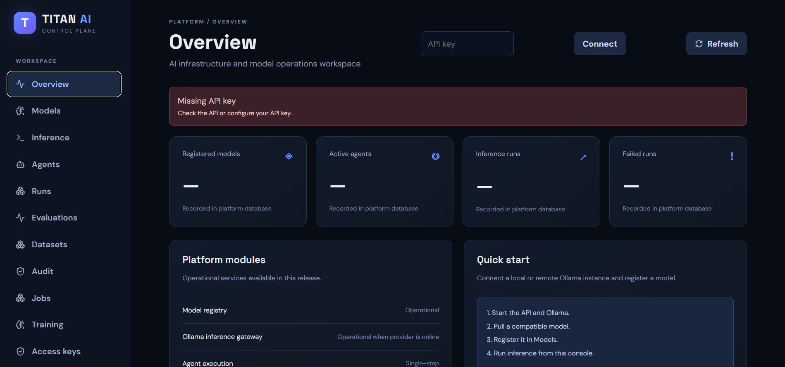
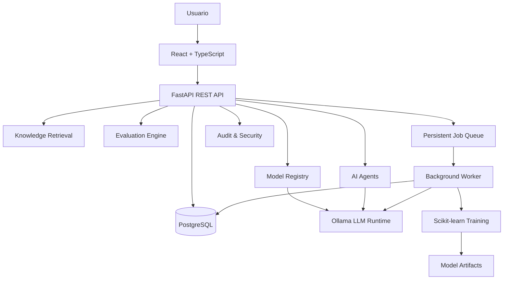
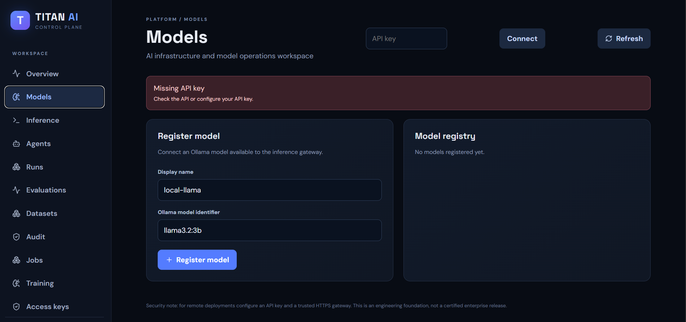
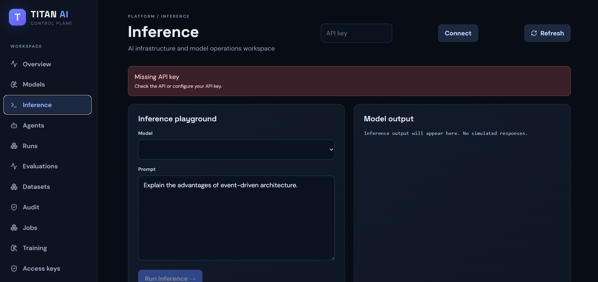
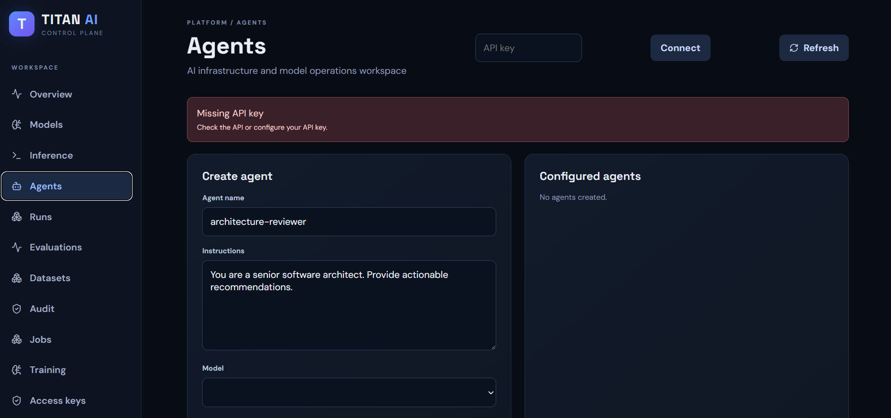
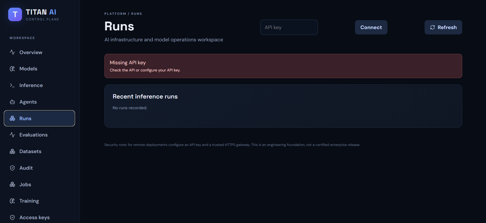
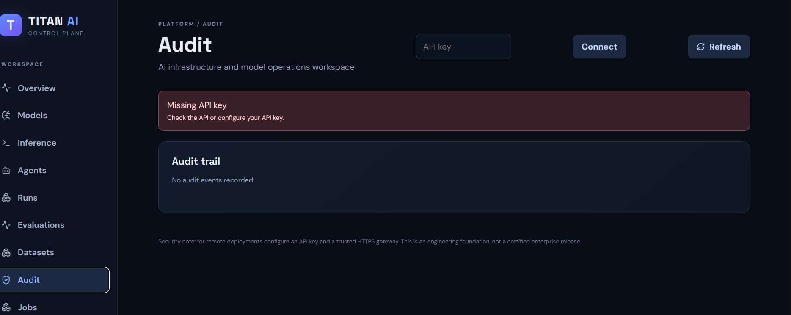
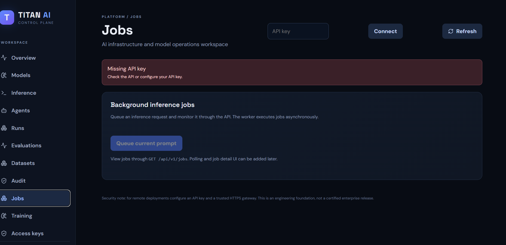
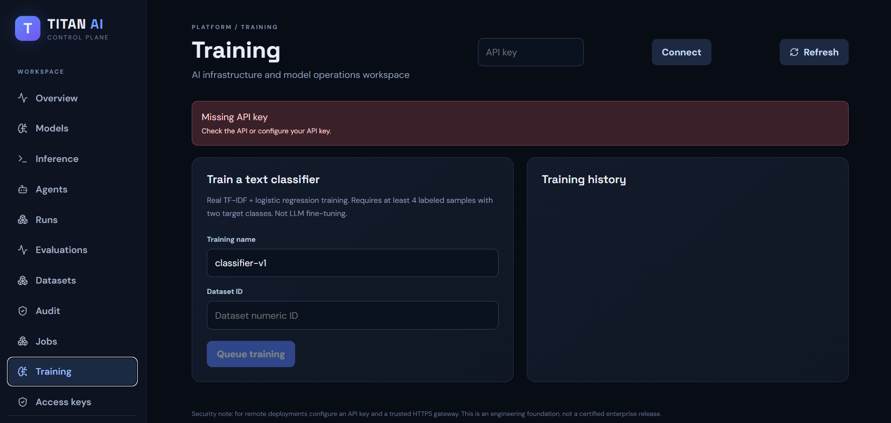
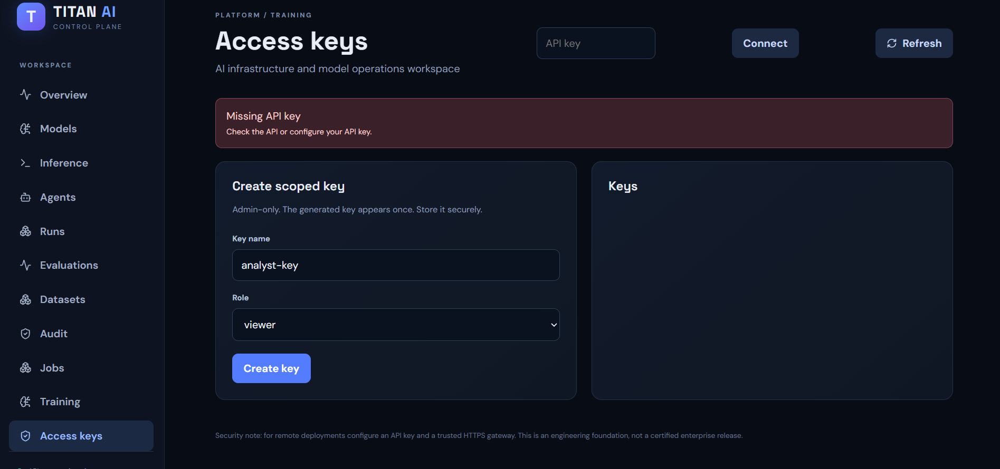

<div align="center">

# TITAN AI

### Advanced AI Engineering & Model Operations Platform

**Plataforma de ingeniería de inteligencia artificial diseñada para integrar modelos de lenguaje, agentes inteligentes, automatización, entrenamiento de Machine Learning y evaluación de sistemas de IA.**


**Versión:** 0.7.x | **Categoría:** Artificial Intelligence Engineering

[Características](#características-principales) •
[Arquitectura](#arquitectura-del-sistema) •
[Instalación](#instalación) •
[Agentes IA](#4-agents) •
[Capturas](#galería-de-capturas) •
[API](#documentación-de-la-api)

</div>

---

## Descripción del proyecto

**TITAN AI** es una plataforma experimental de ingeniería de inteligencia artificial desarrollada como un proyecto avanzado de portafolio profesional.

Su propósito es demostrar conocimientos prácticos de arquitectura de software, inteligencia artificial, desarrollo full-stack, procesamiento asíncrono, bases de datos y Machine Learning mediante la integración de múltiples componentes tecnológicos.

La plataforma proporciona un entorno centralizado desde el cual es posible registrar modelos de IA, ejecutar inferencias, configurar agentes, gestionar trabajos en segundo plano, entrenar clasificadores de texto y evaluar resultados.

A diferencia de una aplicación que simplemente consume una API de inteligencia artificial, TITAN AI reúne distintos mecanismos de ejecución y administración dentro de una arquitectura modular.

### Objetivos técnicos

- Diseñar una arquitectura modular con frontend y backend independientes.
- Integrar modelos de lenguaje ejecutados mediante Ollama.
- Desarrollar una API REST utilizando FastAPI.
- Implementar agentes configurables con instrucciones especializadas.
- Gestionar tareas asíncronas mediante workers independientes.
- Persistir datos, configuraciones y resultados en PostgreSQL.
- Implementar pipelines de entrenamiento de Machine Learning.
- Incorporar herramientas de evaluación y medición.
- Aplicar autenticación basada en API keys y roles.
- Contenerizar servicios mediante Docker.
- Facilitar la ejecución, revisión y reproducción del proyecto.

> **Alcance:** TITAN AI es un proyecto técnico de ingeniería y portafolio. No se presenta como una plataforma comercial certificada ni como una solución validada para producción empresarial.

---

## Características principales

| Módulo | Funcionalidad |
|---|---|
| **Overview** | Monitorización general de modelos, agentes y ejecuciones |
| **Models** | Registro y administración de modelos de Ollama |
| **Inference** | Ejecución de prompts y generación de respuestas |
| **Agents** | Creación y ejecución de agentes configurables |
| **Runs** | Historial de inferencias y métricas de latencia |
| **Evaluations** | Evaluación de respuestas generadas |
| **Datasets** | Registro de conjuntos de datos |
| **Audit** | Registro de operaciones del sistema |
| **Jobs** | Procesamiento de inferencias en segundo plano |
| **Training** | Entrenamiento de clasificadores de texto |
| **Access Keys** | Administración de claves y roles |
| **Knowledge** | Recuperación de información de documentos mediante TF-IDF |
| **Orchestration** | Flujos de recuperación, cálculo y síntesis |
| **Benchmark** | Medición de exactitud, F1 y latencias |

---

## Vista previa

### TITAN AI Control Plane



La interfaz utiliza una estética oscura y una estructura de panel administrativo, permitiendo acceder desde un mismo entorno a los diferentes componentes de la plataforma.

Las capturas corresponden a una ejecución local de TITAN AI. Algunas muestran el aviso `Missing API key` porque fueron realizadas antes de autenticar la sesión.

---

## Arquitectura del sistema

TITAN AI utiliza una arquitectura modular que separa la presentación, la lógica de negocio, el almacenamiento y la ejecución de procesos.



### Componentes arquitectónicos

**Frontend**

Desarrollado con React, TypeScript y Vite. Ofrece una interfaz administrativa para interactuar con los modelos, agentes y servicios de la plataforma.

**Backend**

Implementado con Python y FastAPI. Expone los endpoints REST y coordina la lógica de los distintos módulos.

**Database**

PostgreSQL almacena registros de modelos, agentes, ejecuciones, datasets, evaluaciones y trabajos.

**AI Runtime**

Ollama permite ejecutar modelos de lenguaje y procesar solicitudes de inferencia.

**Background Worker**

Proceso independiente encargado de ejecutar trabajos asíncronos y actualizar sus resultados.

**Machine Learning Engine**

Implementa entrenamiento de clasificadores de texto con TF-IDF y regresión logística.

**Knowledge Engine**

Permite registrar documentos y recuperar contenido mediante técnicas de representación textual y similitud.

---

## Tecnologías utilizadas

| Categoría | Tecnología |
|---|---|
| Lenguaje backend | Python 3.12 |
| Framework backend | FastAPI |
| Lenguaje frontend | TypeScript |
| Framework frontend | React |
| Build frontend | Vite |
| Base de datos | PostgreSQL 16 |
| ORM | SQLAlchemy |
| Validación | Pydantic |
| Modelos de lenguaje | Ollama |
| Machine Learning | Scikit-learn |
| Procesamiento textual | TF-IDF |
| Serialización de modelos | Joblib |
| Contenedores | Docker |
| Orquestación local | Docker Compose |
| Pruebas | Pytest |
| CI | GitHub Actions |

---

## Estructura del repositorio

```text
TITAN_AI/
│
├── README.md
│
└── titan-ai/
    │
    ├── backend/
    │   ├── app/
    │   │   ├── main.py
    │   │   ├── models.py
    │   │   ├── schemas.py
    │   │   ├── db.py
    │   │   ├── config.py
    │   │   ├── security.py
    │   │   ├── inference.py
    │   │   ├── worker.py
    │   │   ├── training.py
    │   │   ├── knowledge.py
    │   │   ├── orchestration.py
    │   │   ├── benchmark.py
    │   │   └── advanced.py
    │   │
    │   ├── tests/
    │   ├── requirements.txt
    │   └── Dockerfile
    │
    ├── frontend/
    │   ├── src/
    │   │   ├── main.tsx
    │   │   └── style.css
    │   ├── package.json
    │   └── Dockerfile
    │
    ├── docs/
    │   └── screenshots/
    │
    ├── infra/
    │   └── k8s/
    │
    ├── scripts/
    │
    ├── compose.yaml
    ├── .env.example
    └── .gitignore
```

---

# Instalación

## Requisitos previos

Para ejecutar TITAN AI localmente necesitas:

- Docker Desktop o Docker Engine.
- Docker Compose.
- Git.
- Conexión a Internet para descargar contenedores y modelos.
- Recursos suficientes para el modelo de lenguaje seleccionado.

## 1. Clonar el repositorio

```bash
git clone https://github.com/Lizano16/TITAN_AI.git
cd TITAN_AI/titan-ai
```

## 2. Configurar variables de entorno

En Windows PowerShell:

```powershell
Copy-Item .env.example .env
```

En Linux o Git Bash:

```bash
cp .env.example .env
```

Edita el archivo `.env`:

```env
POSTGRES_PASSWORD=TU_CONTRASENA_SEGURA
API_KEY=TU_CLAVE_API_SEGURA
```

Reemplaza los valores de ejemplo por secretos privados y aleatorios.

**Nunca publiques el archivo `.env` en GitHub.**

## 3. Construir e iniciar servicios

```bash
docker compose up --build -d
```

Verifica el estado:

```bash
docker compose ps
```

Los servicios principales son:

| Servicio | Descripción |
|---|---|
| `api` | Servidor FastAPI |
| `console` | Interfaz React |
| `postgres` | Base de datos |
| `ollama` | Motor de inferencia |
| `worker` | Procesamiento en segundo plano |

## 4. Descargar el modelo de IA

```bash
docker compose exec ollama ollama pull llama3.2:3b
```

Verifica los modelos instalados:

```bash
docker compose exec ollama ollama list
```

## 5. Acceder a la plataforma

Una vez iniciados los servicios:

**Frontend:**

http://localhost:8081

**Documentación de API:**

http://localhost:8000/docs

**Ollama API:**

http://localhost:11434

En el panel principal introduce la clave configurada en `API_KEY` y presiona **Connect**.

---

# Guía completa de uso

## 1. Overview

Overview es el panel principal de TITAN AI.

Presenta indicadores que permiten consultar:

- Registered Models.
- Active Agents.
- Inference Runs.
- Failed Runs.

Los indicadores utilizan los registros almacenados en la base de datos.


---

## 2. Models

El módulo Models permite registrar modelos de lenguaje disponibles en Ollama.



### Cómo registrar un modelo

Primero instala el modelo:

```bash
docker compose exec ollama ollama pull llama3.2:3b
```

Después ingresa en la sección **Models** y completa:

| Campo | Ejemplo |
|---|---|
| Display Name | `local-llama` |
| Ollama Model Identifier | `llama3.2:3b` |

Presiona **Register Model**.

El modelo aparecerá en **Model Registry**.

**Nota:** registrar un modelo no significa entrenarlo. TITAN AI utiliza el modelo previamente instalado en Ollama.

---

## 3. Inference

Inference permite enviar instrucciones directamente a un modelo de lenguaje y visualizar su respuesta.



### Cómo utilizarlo

1. Abre la sección **Inference**.
2. Selecciona un modelo registrado.
3. Escribe un prompt.
4. Presiona **Run Inference**.
5. Consulta la respuesta en **Model Output**.

### Ejemplo de prompt

```text
Actúa como un ingeniero de software senior.

Explica cómo diseñar una arquitectura basada en microservicios
utilizando Python, FastAPI, PostgreSQL y Docker.

Incluye:
- Componentes.
- Ventajas.
- Desventajas.
- Riesgos de seguridad.
- Recomendaciones de escalabilidad.

Responde en español.
```

Las respuestas son generadas mediante el modelo configurado en Ollama.

---

## 4. Agents

El módulo Agents permite crear agentes especializados con instrucciones permanentes y un modelo de lenguaje asignado.



### ¿Qué es un agente en TITAN AI?

Un agente es una configuración que combina:

- Un nombre identificador.
- Instrucciones especializadas.
- Un modelo de lenguaje.
- Una tarea proporcionada durante la ejecución.

Permite utilizar un modelo con un comportamiento y un propósito definidos.

### Crear tu primer agente

Abre **Agents** y completa los siguientes campos.

**Agent Name:**

```text
architecture-reviewer
```

**Instructions:**

```text
Eres un arquitecto de software senior especializado en
Python, FastAPI, PostgreSQL, Docker y seguridad informática.

Tu responsabilidad es analizar arquitecturas de software,
identificar problemas y proponer soluciones técnicas.

Para cada problema encontrado debes proporcionar:

1. Descripción del problema.
2. Nivel de riesgo.
3. Causa probable.
4. Solución recomendada.
5. Justificación técnica.

Responde siempre en español.
```

En **Model** selecciona:

```text
local-llama
```

Presiona **Create Agent**.

El agente aparecerá en **Configured Agents**.

### Ejecutar el agente

En la interfaz original del proyecto:

1. Busca el agente en **Configured Agents**.
2. Presiona el botón **Run**.
3. Aparecerá una ventana para escribir una tarea.
4. Introduce la tarea y confirma.
5. TITAN AI ejecutará la solicitud.
6. La interfaz cambiará a **Inference**, donde mostrará la respuesta en **Model Output**.

### Ejemplo de tarea

```text
Analiza una arquitectura de software con los siguientes
componentes:

- Backend FastAPI.
- PostgreSQL.
- Autenticación mediante API keys.
- Workers asíncronos.
- Docker Compose.
- Frontend React.

Identifica cinco riesgos técnicos importantes y recomienda
mejoras para seguridad, rendimiento y escalabilidad.
```

### Otros agentes de ejemplo

| Agente | Especialidad |
|---|---|
| `architecture-reviewer` | Arquitectura de software |
| `security-reviewer` | Revisión de seguridad |
| `python-specialist` | Desarrollo Python |
| `database-analyst` | Bases de datos |
| `technical-writer` | Documentación técnica |
| `code-reviewer` | Revisión conceptual de código |

### Limitaciones de los agentes básicos

Los agentes de la consola ejecutan tareas individuales. No disponen automáticamente de memoria conversacional persistente, acceso al sistema de archivos ni navegación web.

Los workflows avanzados con herramientas específicas se encuentran disponibles mediante la API.

---

## 5. Runs

Runs proporciona un historial de ejecuciones de inferencia.



Permite consultar información como:

- Identificador de ejecución.
- Modelo utilizado.
- Estado del proceso.
- Fecha de ejecución.
- Latencia en milisegundos.

Este módulo permite observar el historial operativo y detectar ejecuciones fallidas.

---

## 6. Evaluations

Evaluations permite comprobar respuestas generadas por modelos mediante casos de evaluación.

### Ejemplo

**Title:**

```text
TITAN Smoke Evaluation
```

**Prompt:**

```text
Responde únicamente con la palabra TITAN.
```

**Expected Text:**

```text
TITAN
```

Presiona **Run Evaluation**.

La plataforma comprueba si la respuesta incluye el texto esperado.

Esta evaluación es una comprobación determinista básica, no una evaluación semántica completa de la calidad del modelo.

---

## 7. Datasets

Datasets permite registrar conjuntos de ejemplos utilizados en experimentos de evaluación y entrenamiento.

Cada muestra puede contener:

- `prompt`: texto de entrada.
- `expected_contains`: respuesta esperada o etiqueta, según el proceso.

### Ejemplo

```json
{
  "name": "incident-classification",
  "description": "Dataset de clasificación de incidencias",
  "samples": [
    {
      "prompt": "Intento de acceso no autorizado",
      "expected_contains": "seguridad"
    },
    {
      "prompt": "La API responde lentamente",
      "expected_contains": "rendimiento"
    },
    {
      "prompt": "Credenciales inválidas detectadas",
      "expected_contains": "seguridad"
    },
    {
      "prompt": "Alto consumo de memoria",
      "expected_contains": "rendimiento"
    },
    {
      "prompt": "Permisos insuficientes",
      "expected_contains": "seguridad"
    },
    {
      "prompt": "Consultas SQL demasiado lentas",
      "expected_contains": "rendimiento"
    }
  ]
}
```

Los datasets se almacenan y pueden utilizarse en experimentos posteriores.

Para entrenamientos representativos se necesitan muchos más datos y una evaluación adecuada.

---

## 8. Audit

Audit proporciona registros de determinadas operaciones realizadas dentro de la plataforma.



Su objetivo es mejorar la trazabilidad de las acciones ejecutadas.

Puede utilizarse para investigar operaciones registradas y comprender el comportamiento del sistema.

La consulta de auditoría requiere permisos de administrador.

---

## 9. Jobs

Jobs permite enviar tareas de inferencia para su procesamiento asíncrono.



### Funcionamiento

1. El usuario envía una solicitud.
2. La API registra el trabajo en PostgreSQL.
3. Un worker independiente obtiene el trabajo pendiente.
4. El worker ejecuta la operación.
5. El resultado y su estado se actualizan en la base de datos.

### Estados posibles

| Estado | Significado |
|---|---|
| `queued` | Trabajo pendiente |
| `running` | Trabajo ejecutándose |
| `completed` | Trabajo finalizado |
| `failed` | Error durante la ejecución |
| `cancelled` | Trabajo cancelado |

### Consultar trabajos

Desde la API:

```http
GET /api/v1/jobs
```

Para consultar uno específico:

```http
GET /api/v1/jobs/{job_id}
```

La interfaz permite enviar solicitudes a la cola. La consulta detallada de trabajos está disponible principalmente mediante la API.

---

## 10. Training

Training permite entrenar clasificadores de texto utilizando técnicas de Machine Learning.



### Tecnologías utilizadas

- Scikit-learn.
- TF-IDF.
- Logistic Regression.
- Joblib.

### Funcionamiento

El sistema transforma textos en representaciones numéricas y entrena un clasificador supervisado.

### Cómo entrenar un modelo

1. Crea un dataset con ejemplos etiquetados.
2. Registra varias muestras de cada clase.
3. Obtén el identificador numérico del dataset.
4. Ingresa en **Training**.
5. Introduce un nombre para el entrenamiento.
6. Especifica el **Dataset ID**.
7. Presiona **Queue Training**.
8. Consulta el resultado en **Training History**.

### Ejemplo

**Training Name:**

```text
incident-classifier-v1
```

**Dataset ID:**

```text
1
```

El ID debe corresponder a un dataset existente en tu base de datos.

### Resultados

El entrenamiento puede generar:

- Un clasificador entrenado.
- Métricas de evaluación.
- Información sobre el proceso.
- Un artefacto serializado.

**Importante:** este módulo implementa entrenamiento de Machine Learning clásico. No realiza fine-tuning de modelos LLM mediante LoRA o QLoRA.

---

## 11. Access Keys

Access Keys permite administrar claves para acceder a los recursos protegidos de la API.



### Roles disponibles

| Rol | Descripción |
|---|---|
| `viewer` | Consulta de información |
| `operator` | Operaciones y ejecuciones |
| `admin` | Administración y permisos elevados |

### Crear una clave

1. Entra en **Access Keys**.
2. Especifica un nombre.
3. Selecciona el rol.
4. Presiona **Create Key**.
5. Guarda la clave generada en un lugar seguro.

Las claves pueden administrarse y revocarse mediante los endpoints correspondientes.

La API key configurada en `.env` se utiliza como clave inicial de acceso.

---

# Knowledge Retrieval

TITAN AI incorpora un módulo experimental de recuperación documental.

El sistema permite registrar documentos y realizar búsquedas utilizando TF-IDF.

## Registrar un documento

Endpoint:

```http
POST /api/v1/knowledge/documents
```

Ejemplo:

```json
{
  "title": "API Security Guidelines",
  "content": "Las APIs deben validar autenticación, autorización, entradas de usuario y registrar operaciones críticas."
}
```

## Buscar información

Endpoint:

```http
POST /api/v1/knowledge/search
```

Ejemplo:

```json
{
  "question": "¿Qué controles de seguridad deben implementar las APIs?",
  "top_k": 3,
  "model_name": "local-llama"
}
```

El sistema puede recuperar documentos relevantes y utilizar el modelo configurado para sintetizar una respuesta.

La recuperación está basada en TF-IDF y similitud textual, no en embeddings vectoriales de un modelo semántico.

---

# AI Orchestration

TITAN AI incluye flujos de trabajo con herramientas controladas.

Entre las acciones disponibles se encuentran:

- `retrieve`: recuperación documental.
- `calculate`: operaciones aritméticas controladas.
- `synthesize`: generación de una respuesta mediante un modelo.

## Ejemplo de workflow

Endpoint:

```http
POST /api/v1/orchestration/workflows
```

```json
{
  "task": "Analiza la información y genera una respuesta",
  "model_name": "local-llama",
  "steps": [
    "retrieve",
    "calculate",
    "synthesize"
  ],
  "expression": "(20 + 30) / 5",
  "max_documents": 3
}
```

Un workflow puede producir evidencias recuperadas, resultados de cálculo, respuestas del modelo y trazas de ejecución.

---

# Evaluación y Benchmark

La plataforma incluye herramientas para medir distintos aspectos del comportamiento de sistemas de IA.

Entre las métricas contempladas están:

| Métrica | Objetivo |
|---|---|
| Exact Match | Comparación exacta |
| Token F1 | Coincidencia entre tokens |
| Recall@K | Recuperación de elementos relevantes |
| Latencia | Tiempo de ejecución |
| Estado | Resultado operativo |

Estas métricas ayudan a comparar resultados y detectar posibles problemas.

No constituyen por sí solas una certificación de precisión, seguridad o fiabilidad de un modelo.

---

# Galería de capturas

Las siguientes imágenes muestran las diferentes secciones de TITAN AI durante su ejecución local.

### Dashboard / Overview


### Model Registry


### Inference Playground


### AI Agents


### Inference History


### Audit Trail


### Background Jobs


### Machine Learning Training


### Access Key Management


---

# Documentación de la API

FastAPI genera documentación interactiva mediante Swagger UI.

Acceso local:

**http://localhost:8000/docs**

## Endpoints principales

| Método | Endpoint |
|---|---|
| GET | `/api/v1/overview` |
| GET | `/api/v1/models` |
| POST | `/api/v1/models` |
| POST | `/api/v1/inference` |
| GET | `/api/v1/agents` |
| POST | `/api/v1/agents` |
| POST | `/api/v1/agents/{agent_id}/run` |
| GET | `/api/v1/runs` |
| GET | `/api/v1/datasets` |
| POST | `/api/v1/datasets` |
| GET | `/api/v1/jobs` |
| POST | `/api/v1/jobs` |
| GET | `/api/v1/training` |
| POST | `/api/v1/training` |
| GET | `/api/v1/evaluations` |
| POST | `/api/v1/evaluations` |
| GET | `/api/v1/audit` |
| POST | `/api/v1/knowledge/search` |
| POST | `/api/v1/orchestration/workflows` |
| POST | `/api/v1/benchmark/score` |

La documentación interactiva permite explorar los esquemas reales, los parámetros y las respuestas de cada endpoint.

---

# Seguridad

TITAN AI incorpora controles básicos como:

- Autenticación mediante API keys.
- Roles de acceso.
- Restricciones sobre operaciones protegidas.
- Registro de acciones.
- Separación de servicios.
- Configuración mediante variables de entorno.

## Recomendaciones

- Nunca publiques `.env`.
- No incluyas claves privadas en commits.
- No utilices credenciales de demostración en servicios públicos.
- Revisa las dependencias.
- Utiliza HTTPS y controles adicionales antes de cualquier despliegue accesible desde Internet.
- Evita publicar datos sensibles en datasets o capturas.

El sistema es una demostración de ingeniería y no debe considerarse una plataforma de seguridad corporativa certificada.

---

# Pruebas automatizadas

El backend incluye pruebas desarrolladas con Pytest.

Para ejecutarlas:

```bash
cd titan-ai/backend
pip install -r requirements.txt
pip install -r requirements-dev.txt
pytest -q
```

Las pruebas permiten verificar distintas operaciones del backend, incluyendo endpoints, trabajos, evaluaciones y orquestación.

La compilación del frontend puede comprobarse mediante:

```bash
cd titan-ai/frontend
npm install
npm run build
```

También se incluye una configuración de GitHub Actions para automatización de pruebas.

---

# Solución de problemas

## Missing API key

Comprueba que el campo **API key** contenga el valor configurado en `.env`.

Presiona **Connect** para autenticar la sesión.

## No models registered

Descarga un modelo con Ollama:

```bash
docker compose exec ollama ollama pull llama3.2:3b
```

Después regístralo desde Models.

## El panel no abre

Comprueba los servicios:

```bash
docker compose ps
```

Revisa los registros:

```bash
docker compose logs --tail=100
```

## La inferencia no responde

Comprueba que Ollama esté ejecutándose y que el identificador del modelo registrado coincida con un modelo instalado.

```bash
docker compose exec ollama ollama list
```

## Error de puerto ocupado

Modifica el puerto externo correspondiente en `compose.yaml` y reinicia los servicios.

## Detener TITAN AI

```bash
docker compose down
```

Este comando detiene y elimina los contenedores del proyecto, pero conserva los volúmenes persistentes.

---

# Competencias técnicas demostradas

El desarrollo de TITAN AI permite estudiar y demostrar conocimientos relacionados con:

**Software Engineering**

- Diseño modular.
- APIs REST.
- Arquitectura cliente-servidor.
- Integración de servicios.
- Persistencia de datos.

**Artificial Intelligence Engineering**

- Integración de LLM.
- Inferencia.
- Agentes configurables.
- Recuperación documental.
- Evaluación de resultados.

**Machine Learning**

- Preparación de datasets.
- Clasificación supervisada.
- Entrenamiento con scikit-learn.
- Métricas de evaluación.
- Serialización de modelos.

**DevOps**

- Docker.
- Docker Compose.
- Git.
- GitHub Actions.
- Gestión de configuración.

---

# Alcance y evolución

TITAN AI representa una plataforma experimental con funcionalidades funcionales de integración y administración de inteligencia artificial.

Entre las posibles ampliaciones se encuentran:

- Fine-tuning de modelos de lenguaje.
- Búsqueda semántica mediante embeddings.
- Orquestación avanzada de múltiples agentes.
- Streaming de respuestas.
- Evaluación semántica y de seguridad.
- Observabilidad avanzada.
- Escalabilidad distribuida.
- Gestión de recursos GPU.
- Integración con plataformas cloud.
- Autenticación empresarial OIDC.

Estas mejoras representan objetivos de evolución y no funcionalidades que se afirme tener ya implementadas.

---

# Capturas e imágenes del repositorio

Las imágenes utilizadas en este README deben almacenarse en:

```text
titan-ai/docs/screenshots/
```

Con los siguientes nombres:

```text
overview.png
models.png
inference.png
agents.png
runs.png
audit.png
jobs.png
training.png
access-keys.png
```

Las imágenes se mostrarán automáticamente en GitHub cuando estos archivos existan en la rama publicada, respetando exactamente los nombres y las rutas.

---

# Autor

**Erick Alejandro González Lizano**

Ingeniería en Sistemas

Intereses profesionales:

- Ingeniería de software.
- Inteligencia artificial.
- Desarrollo backend.
- Machine Learning.
- Arquitectura de sistemas.
- Automatización tecnológica.

**GitHub:** [@Lizano16](https://github.com/Lizano16)

**Repositorio:** [TITAN_AI](https://github.com/Lizano16/TITAN_AI)

---

<div align="center">

### TITAN AI

**Artificial Intelligence Engineering • Software Architecture • Machine Learning**

*Proyecto técnico de portafolio enfocado en la integración de sistemas de inteligencia artificial y en la demostración de conocimientos de ingeniería de software.*

</div>
