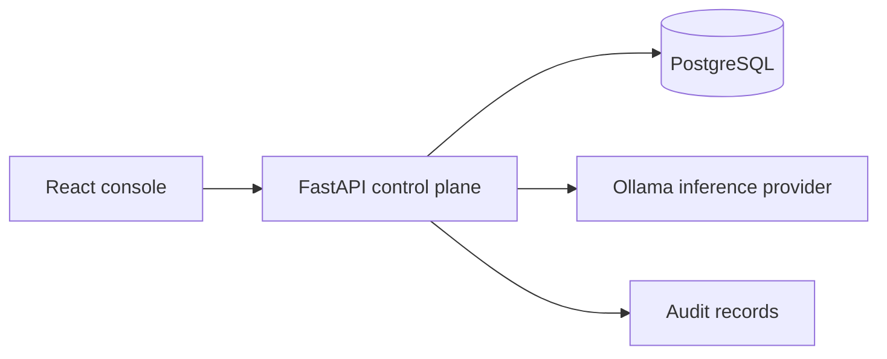
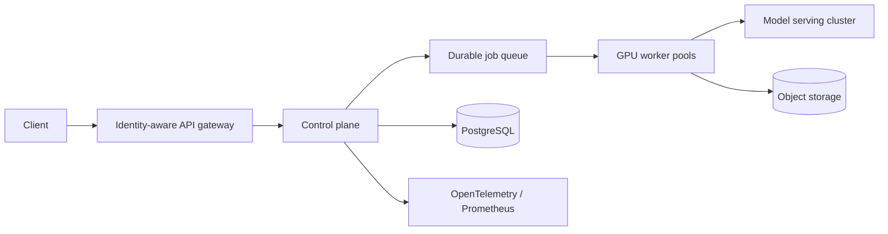

# TITAN AI architecture

## Current implementation (v0.1)

- Model registry persists provider metadata and model identifiers.
- Inference requests execute synchronously through Ollama, with timeout and recorded outcomes.
- Agents are instruction-bound single-step executions, not autonomous multi-agent systems.
- Audit events cover model creation, agent creation, and inference completion.
- Development API key is a temporary access control, not a production identity solution.

## Production architecture target

Production readiness requires OIDC/RBAC, multi-tenancy, isolated job execution, quotas, secret management, durable scheduling, Kubernetes operators, load testing, migration tooling, SLOs, backup/restore, and security review. These are roadmap items, not shipped capabilities.
